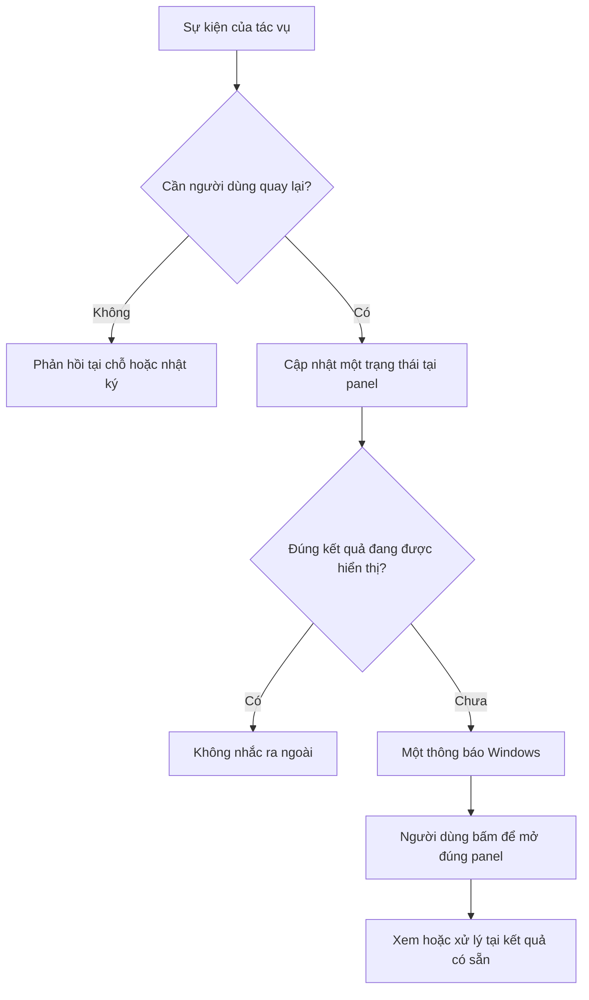

# Thiết kế lại kênh thông báo — 18/10/2026

Trạng thái: người dùng đã duyệt bằng “Tiếp tục”; triển khai và cài 2.20.70.
Xem [kết quả và kiểm chứng](../releases/notes/NOTIFICATIONS_2.20.70.md). Phần dưới giữ phương án
đã duyệt. Lúc lập tài liệu, bản đang cài là 2.20.68; gói 2.20.69 chưa cài.
Phương án này thay hướng giữ cửa sổ xem riêng và chỉ vá thêm tín hiệu chú ý.

## 1. Quyết định thiết kế

**Panel là nơi duy nhất xem đầy đủ kết quả và ra quyết định. Windows chỉ
nhắc người dùng quay lại khi họ đang làm việc khác. Bỏ cửa sổ riêng sao chép
panel. Một sự kiện không được bật nhiều cách thu hút chú ý cùng lúc.**

Loại bỏ chức năng thừa, không chuyển nó sang một tùy chọn ẩn. Người dùng
không phải chọn giữa panel, cửa sổ xem, toast và tự chuyển focus.

Phân biệt thông tin lưu tại panel với việc làm gián đoạn: kết quả vẫn ở
panel sau khi toast hết, nhưng khi quay về không bật thêm hộp thoại đọc lại.
Toast chỉ nêu việc cần quay lại; chi tiết/hành động chỉ có tại panel.

## 2. Vấn đề xác minh trong mã nguồn hiện tại

| Vị trí | Hiện trạng | Thay đổi đề xuất |
| --- | --- | --- |
| `index.html` — `noticeNativeReview`; `main.js` — handler cùng tên | Nút mở cửa sổ để xem lại sự kiện đang nằm trong panel | Bỏ nút và handler |
| `NotificationHost.cs` — `ShowReview()` | Cửa sổ nhận cùng title/message/impact, thêm nút mở panel/đóng | Bỏ cửa sổ có giao diện và đường lệnh `review` |
| `native-notifications.js` — `review()`; `NotificationProtocol.cs` | Kênh IPC phục vụ việc đọc lại trong cửa sổ | Bỏ API/lệnh này; giữ helper phục vụ toast và mở đúng panel |
| `index.html` — `focusOnIncident`, `externalNotifications` | Hai tùy chọn thu hút chú ý có thể cùng bật | Thay bằng một lựa chọn nhắc ngoài ứng dụng; không tự giành focus |
| `main.js` — `noticeEnvironment()` | Dùng focus của document để suy ra người dùng đang ở nền | Phân biệt panel đang hiển thị, Premiere đang ở trước và panel có focus nhập liệu |
| `index.html` — `status`, `runHealth`, `workflowNotice`; `finishRunNotice()` | Cùng tác vụ có thể có nhiều dòng cùng nói trạng thái/kết quả | Gom một vùng trạng thái tác vụ, cập nhật theo giai đoạn |

Focus ở timeline không đồng nghĩa đã chuyển sang ứng dụng khác. Tên class
`banner` hay `result-card` trong policy cũng không bảo đảm giao diện đã hết
trùng lặp; phải kiểm kết quả render thật.

## 3. Phân công kênh

| Tình huống | Người dùng đang xem panel | Người dùng đang ở ứng dụng khác |
| --- | --- | --- |
| Thiếu SRT, nguồn audio sai, tham số sai | Lỗi ngay cạnh mục cần sửa | Không gửi toast cho lỗi nhập liệu |
| Đang chạy, tạm dừng, chờ Premiere phản hồi | Một vùng tiến trình | Không gửi tiến độ/thông báo treo suy đoán |
| Hoàn tất bình thường | Một thẻ kết quả | Một toast hoàn tất, kể cả tác vụ ngắn |
| Hoàn tất có vùng cần xem lại | Một thẻ kết quả có mục Cần kiểm tra | Một toast: hoàn tất và có việc cần kiểm tra; không tách thành hai thông báo |
| Không thể hoàn tất | Một thẻ lỗi, nêu bước xử lý và ảnh hưởng | Một toast yêu cầu quay lại; lỗi chi tiết chỉ ở panel |
| Cần phê duyệt thật sự | Một khung quyết định trong panel | Một toast Cần quyết định; tác vụ đợi tại điểm an toàn |
| Dừng tác vụ đang chờ hoàn tất | Cập nhật đang dừng rồi kết quả/ảnh hưởng | Chỉ nhắc khi đã dừng xong nếu người dùng đã rời ứng dụng |
| Khôi phục mặc định, xuất log, quét thành công, fallback đã tự xử lý | Phản hồi tại thao tác hoặc nhật ký | Không nhắc |

Hoàn tất ở nền là thông tin quan trọng theo yêu cầu mới của người dùng;
không giữ quy tắc cũ thành công bình thường luôn im lặng.

Tắt nhắc ngoài ứng dụng thì giữ trạng thái chưa xem tại panel, không dùng
cửa sổ riêng hay tự chuyển focus để vượt lựa chọn đó. Không dùng alarm,
reminder hoặc topmost để vượt chế độ Không làm phiền. Nếu Windows chưa cho
hiện banner, báo tình trạng tại phần hỗ trợ; không tự bật thêm một popup.

## 4. Giao diện và nội dung

Một vùng ngay dưới nút chạy chuyển lần lượt: Sẵn sàng → Đang xử lý → Kết
quả; có trạng thái Chờ quyết định, Đang dừng hoặc Lỗi khi thực sự xảy ra.
Thông tin run health nằm trong vùng này, không thành thông báo độc lập.

Ví dụ minh họa, không phải một kết quả mới đã thực thi:

| Trường hợp | Toast khi đang ở nền | Nội dung tại panel |
| --- | --- | --- |
| Thành công | **Đã tạo phụ đề xong.** — Mở kết quả | **Đã tạo 468 phụ đề.** Kết quả và Chi tiết; không nút OK/Đã đọc |
| Cần kiểm tra | **Đã hoàn tất — có vùng cần kiểm tra.** — Mở kết quả | **Có 3 vùng cần nghe lại.** Nút Xem 3 vùng, kèm đúng vị trí đầu ra |
| Lỗi | **Tạo phụ đề chưa hoàn tất.** — Mở để xử lý | Nguyên nhân dễ hiểu, tác động tới timeline và một bước sửa phù hợp |
| Phê duyệt | **Cần quyết định để tiếp tục.** — Mở panel | Hệ quả cụ thể và hai nút hành động, ví dụ Hủy / Bắt đầu dựng |

Toast có tối đa một nút mở đúng ngữ cảnh; không chép toàn bộ nội dung panel,
không có nút chạy lại, phê duyệt, Save hoặc Undo. Tiêu đề phải phân biệt
Dựng theo voice và Tạo phụ đề. Không hiện đường dẫn, lời thoại hay mã lỗi thô.

Panel giữ một tóm tắt ngắn, tối đa hai hành động phù hợp. Chi tiết thu gọn
chứa vị trí/phụ đề cần kiểm tra; nhật ký kỹ thuật nằm sâu hơn. Không lặp tiêu
đề bằng một câu khác có cùng nghĩa. Thông tin chương trình không tự lưu
project chỉ xuất hiện một lần, không biến thành cảnh báo phải xác nhận.

Phê duyệt chỉ dùng cho quyết định có hệ quả: dựng timeline, xóa dữ liệu hoặc
tiếp tục sau trạng thái cần xác minh. Khung này thay vùng trạng thái khi đang
chờ quyết định; không đồng thời mở một cửa sổ Windows mang cùng nội dung.
Đóng/Xem thông báo không đồng nghĩa đã khôi phục, đồng ý chạy lại hay lưu.

## 5. Đọc một lần, xử lý một nơi

Một sự kiện có danh tính theo phiên, tác vụ và lần chuyển trạng thái có ý
nghĩa. Panel, toast và lịch sử tham chiếu cùng trạng thái, không tạo ba bản
sao độc lập. Mỗi sự kiện chưa xem chỉ nhắc một lần.

- Cảnh báo bổ sung cho cùng kết quả cập nhật thẻ hiện có; không phát từng
  toast cho từng vùng, mỗi dòng warn, fallback hay cleanup.
- Chờ phê duyệt rồi hoàn tất sau khi người dùng tiếp tục là hai trạng thái
  khác nhau, có thể cần hai lần nhắc ở hai thời điểm; không giới hạn máy móc
  một thông báo cho cả lượt chạy dài.
- Chỉ đánh dấu đã xem khi đúng thẻ kết quả/khung quyết định thực sự hiển thị
  trong panel đang ở trước, hoặc người dùng chủ động mở mục đó. Không suy ra
  đã xem chỉ từ việc mở Premiere, API báo submitted hoặc đóng toast Windows.
- Khi đã xem, dọn toast tương ứng khỏi Notification Center; kết quả và vấn
  đề chưa xử lý vẫn ở panel. Đánh dấu đã xem không gỡ khóa phục hồi.
- Người dùng quay lại trước khi lệnh gửi nền hoàn tất: hủy lần nhắc đang chờ.
  Mở Chi tiết/lịch sử hoặc cập nhật render không phát lại thông báo.
- Bấm toast cũ không áp dụng hành động vào tác vụ mới. Khi trạng thái cũ hết
  hiệu lực, dọn toast; không lấy lại focus, mở lại xác nhận cũ hoặc đổi kết quả.
- Sự kiện quan trọng hơn thay tóm tắt của tác vụ; thông báo phụ không che hoặc
  ghi đè quyết định/lỗi đang cần xử lý. Không đưa xác nhận chưa xem thành lịch
  sử rồi tự coi như đã được duyệt.

Nhận diện panel đang xem cần kết hợp trạng thái hiển thị của CEP với cửa sổ
Premiere thuộc đúng phiên/chuỗi tiến trình. Trạng thái không xác minh được
không được coi là người dùng đã đọc; với kết quả quan trọng, giữ quyền nhắc
một lần. Kiểm lại ngay trước khi phát ra ngoài, tránh race giữa callback và
người dùng quay về. Không thể suy ra người dùng đang nhìn màn hình bằng API.

## 6. Thiết lập tối giản

Chỉ giữ một lựa chọn mặc định bật:

> ☑ Nhắc khi hoàn tất hoặc cần tôi xử lý
>
> Hiện thông báo Windows khi tôi đang dùng ứng dụng khác.

Bỏ lựa chọn tự đưa Premiere lên trước. Chỉ mở/kích hoạt Premiere khi người
dùng bấm thông báo. Không nháy taskbar song song với toast trong thiết kế
chính; không thêm lựa chọn kênh hoặc bật nhiều cửa sổ để bù cho sự trùng lặp.
Âm thanh vẫn im lặng, không thêm tùy chọn âm thanh trong đợt này.

Giữ lựa chọn bật/tắt nhắc Windows đã lưu; ngừng dùng lựa chọn focus cũ, không
biến focus=true thành quyền bật lại thông báo đã tắt. Hướng dẫn thay đổi này
đặt trong thiết lập/hướng dẫn sử dụng, không thành một popup mới.

Đặt **Thử thông báo** trong Hỗ trợ: phép thử có nhãn rõ, không thay thế kết
quả tác vụ hiện tại và không đụng project. Chẩn đoán quyền/giao nhận ở đây,
không đưa từ helper, AUMID hoặc foreground vào luồng người dùng chính.

## 7. Phạm vi triển khai sau khi phương án được chấp thuận

1. Lập bảng các chỗ tạo sự kiện ở cả hai workflow và thao tác phụ. Xác định
   trạng thái/nguyên nhân/hành động; không dựa vào màu log để quyết định nhắc.
2. Bỏ `noticeNativeReview`, `review()` trong bridge, lệnh `review` và
   `ShowReview()` có giao diện; cập nhật test/preview/docs liên quan. Helper
   còn phục vụ toast và mở panel, không cần đổi công nghệ toàn chương trình.
3. Hợp nhất status/run health/result và trình bày phê duyệt trong một vùng;
   giữ cảnh báo ảnh hưởng và chi tiết, không giấu vấn đề đang cần giải quyết.
4. Viết lại bộ định tuyến theo trạng thái quan sát được, dấu đã xem và một
   kênh nhắc. Bỏ đường tự giành focus/nháy taskbar tự động từ thiết kế69.
   Việc mở đúng panel khi bấm toast phải được kiểm thực, không chỉ gọi API.
5. Chuyển thiết lập cũ, kiểm callback cũ, ghi log định tuyến/giao nhận theo
   trường cho phép, giới hạn lưu trữ; không ghi lời nói, tên media hoặc lỗi thô.
6. Chạy hồi quy liên quan, kiểm bố cục và kiểm native; sau đó đóng gói/cài
   theo quy trình sao lưu/xác minh. Bản69 hiện tại không phải gói triển khai
   phương án này; chưa dùng nó để thay cho đợt thiết kế được yêu cầu.

Giữ các chốt Dừng/Tạm dừng, phục hồi audio/In-Out, trạng thái dữ liệu đã đổi
hoặc chưa biết, khóa chạy đè và kiểm tra trước khi tiếp tục. Không sửa thuật
toán nhận diện/căn thời gian, tự Save/Undo hoặc tự đóng/điều khiển project.

## 8. Tiêu chí nghiệm thu

| Ca kiểm | Kết quả cần đạt |
| --- | --- |
| Hoàn tất khi panel đang xem | Một kết quả; 0 toast, 0 cửa sổ xem riêng, 0 tự chuyển focus |
| Hoàn tất lúc dùng app khác | Một toast, 0 cửa sổ xem riêng; bấm mở đúng kết quả có sẵn |
| Cảnh báo nhiều vùng/cleanup/fallback | Không phát thêm thông báo theo từng dòng; vùng cần kiểm vẫn đầy đủ |
| Người dùng đọc tại panel trước khi toast gửi xong | Không xuất hiện toast muộn của kết quả đã xem |
| Đã xem rồi mở lịch sử/Chi tiết | Không nhắc lại; toast cũ được dọn |
| Phê duyệt thật sự khi ở nền | Một lời nhắc; một khung quyết định trong panel; chưa bấm thì không tự chạy tiếp |
| Thiếu SRT/tham số sai | Chỉ lỗi đúng trường; 0 toast/khung lỗi trùng |
| Tắt nhắc/Windows chặn/Không làm phiền | Không mở cửa sổ hay giành focus để vượt thiết lập; kết quả vẫn được giữ |
| Lỗi/dừng sau thay đổi hoặc trạng thái chưa biết | Đọc/đóng toast không mở khóa phục hồi hoặc chạy lại |
| Callback/nhấp toast của tác vụ cũ | Không tác động kết quả hay quyết định của tác vụ mới |
| CEP focus ở timeline/panel ẩn/Premiere thu nhỏ | Định tuyến theo trạng thái hiển thị thực, không chỉ document.hasFocus |
| Hai luồng chạy và 320/385/560px, bàn phím/DPI | Một vùng rõ ràng, không che nút, không tràn; đọc trạng thái không lặp |

Kiểm bộ định tuyến, bridge/protocol, vòng đời và dữ liệu bảo mật bằng test;
kiểm banner/click/mở panel thật trên Windows và Premiere riêng. Người dùng
đã xác nhận toast kiểm thử69 có banner; bằng chứng đó không xác nhận thiết
kế mới, việc click hay cơ chế đánh dấu đã xem. Cài đặt vẫn cần Premiere/helper
đã đóng và đối chiếu dữ liệu trước/sau, không tự đóng ứng dụng.

## 9. Cơ sở tham khảo

Các quy tắc và giới hạn trong tài liệu là lựa chọn thiết kế cho chương trình,
không phải mọi thứ đều là yêu cầu bắt buộc của Windows.

- [Microsoft: Notifications design basics](https://learn.microsoft.com/en-us/windows/apps/develop/notifications/app-notifications/app-notifications-ux-guidance): mục đích rõ, giảm gián đoạn, mở đúng ngữ cảnh, dọn thông báo đã xem.
- [Microsoft: Dialog controls](https://learn.microsoft.com/en-us/windows/apps/develop/ui/controls/dialogs-and-flyouts/dialogs): nội dung ngắn, không lặp tiêu đề, nút nêu hành động, lỗi nhập liệu đặt tại trường.
